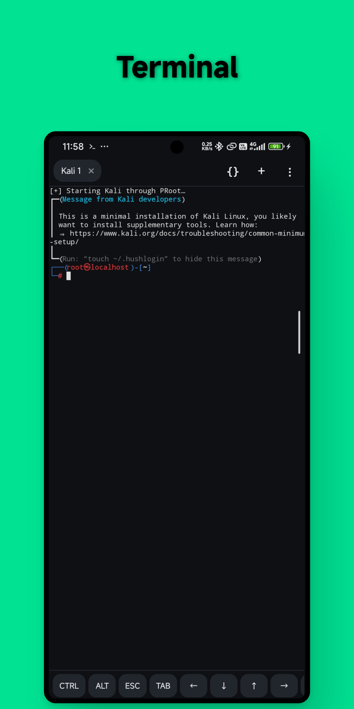
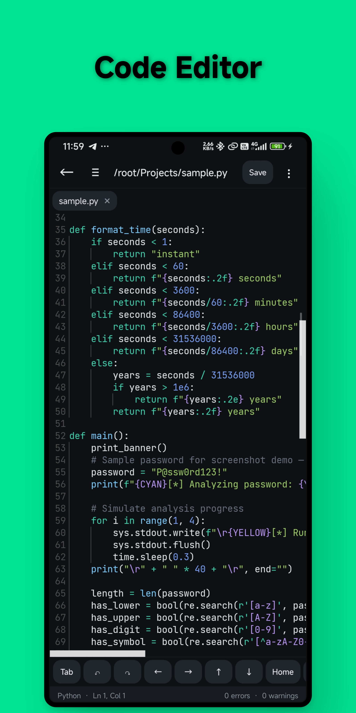
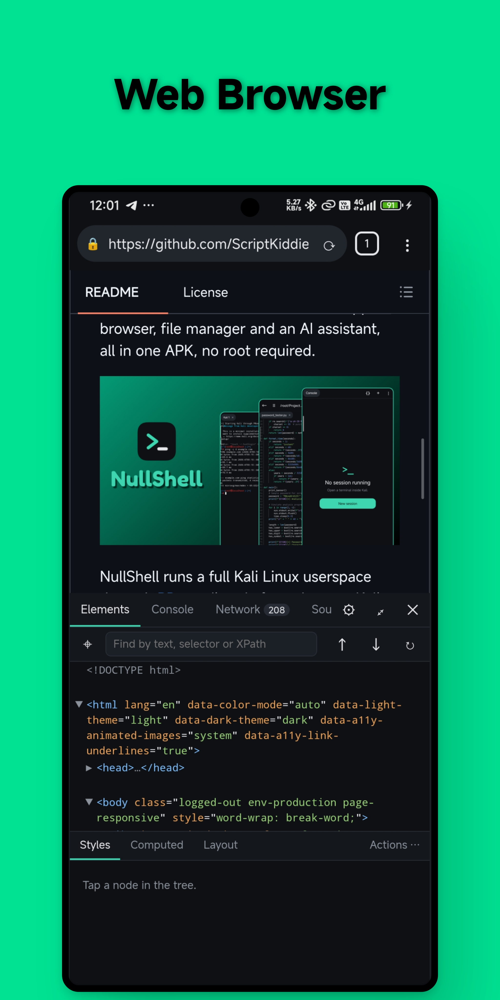
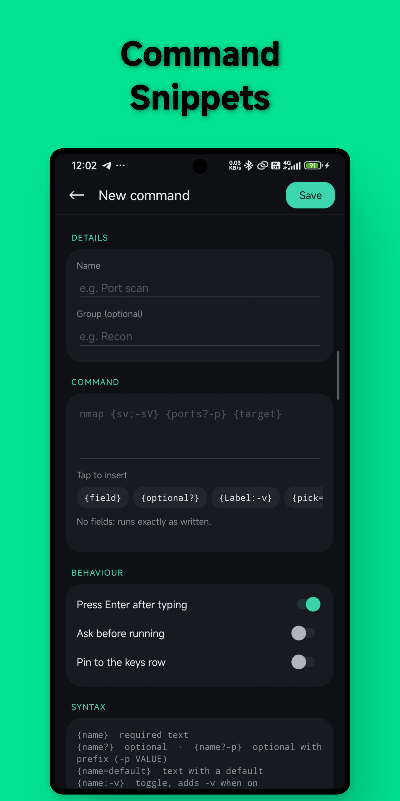
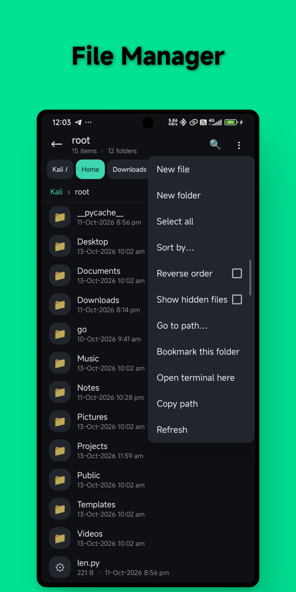
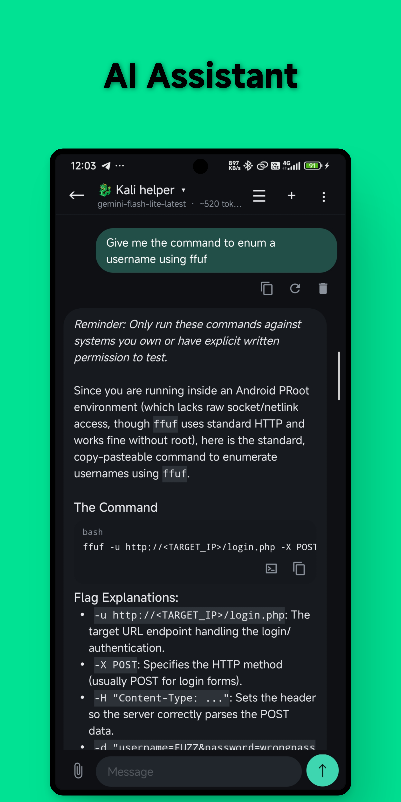

<div align="center">

# NullShell

**Kali Linux, a code editor, a dev-tools browser and an AI assistant — in one APK. No root.**

[](https://github.com/ScriptKiddieZed/NullShell/actions/workflows/build.yml)
[](LICENSE)


[](https://github.com/ScriptKiddieZed/NullShell/releases)

[Download](https://github.com/ScriptKiddieZed/NullShell/releases) · [Features](#features) · [Build](#building-from-source) · [Contribute](#contributing)


</div>

NullShell runs a full Kali Linux userspace through [PRoot](https://proot-me.github.io/), directly from the app — terminal, code editor, in-app browser, file manager and an AI assistant, all in one APK, no root required. Kali Linux is a trademark of OffSec; NullShell is not affiliated with or endorsed by it.

## Why NullShell?

- **Everything in one app.** Terminal, editor with language servers, a browser with DevTools-style panels, a file manager and an AI chat, instead of juggling several apps.
- **Made for security work on a phone.** Point the built-in browser at your own mitmproxy, Caido or Burp using an app-private CA certificate, without touching the system trust store.
- **Real Kali userspace.** `apt install` the tools you already know, and run a full IceWM desktop over VNC.
- **Works out of the box.** The PRoot runtime is bundled, so there is no manual setup step.
- **Open source (MIT).** Third-party components keep their own licenses, listed in [THIRD_PARTY_NOTICES.md](THIRD_PARTY_NOTICES.md).

## Quick start

1. Download the latest APK from [Releases](https://github.com/ScriptKiddieZed/NullShell/releases) and install it (allow installs from your browser or file manager if Android asks).
2. Open NullShell and let it set up the Kali userspace on first launch.
3. Run `apt update && apt install <your tools>` in the terminal.

Requirements: an ARM64 device running Android 8.0 (API 26) or newer.

## Features

### Terminal

<details>
  <summary>📱 Click to view screenshot</summary>
  <br>
  
</details>

- A real Kali Linux userspace (ARM64), launched through PRoot — install packages with `apt`, run the tools you already know.
- Background jobs run as a foreground service, so long commands keep going while you switch apps.
- A pure-Java terminal fast path, scrollback limits and other memory controls so long sessions stay responsive on phones.
- Sessions live in a left-hand drawer (the ☰ button or a tap on the title); rename a session with the pencil or a long-press, and the top bar shows the current session's name and state.
- Nerd Fonts: download JetBrains Mono, Fira Code, Hack, Meslo, Caskaydia Cove, Ubuntu Mono or Sauce Code Pro (patched with icons for Starship, Powerlevel10k, eza, lsd and similar) from Settings > Terminal, with real bold.

### Code editor

<details>
  <summary>📱 Click to view screenshot</summary>
  <br>
  
</details>

- Built on [sora-editor](https://github.com/Rosemoe/sora-editor), with TextMate-grammar syntax highlighting and Language Server Protocol support.
- Highlighting and/or an LSP-backed language server (for diagnostics, completion and formatting) for: Python, JavaScript, TypeScript, JSON, HTML, CSS, XML, Markdown, Shell, C, C++, YAML, Java, Kotlin, Lua, Go, Rust, PHP, Ruby, SQL, Dockerfile, Makefile, INI/config files and Diff/patch files.
- Language servers install on demand into the Kali userspace (e.g. `pylsp`, `typescript-language-server`, `clangd`, `gopls`, `rust-analyzer`, `intelephense`, `solargraph`), with per-server memory caps and idle shutdown.
- Large-file mode and tab unloading keep memory in check when editing big projects.
- Open text files from other apps directly into the NullShell editor, and jump from the editor to "show in file manager".

### In-app browser

<details>
  <summary>📱 Click to view screenshot</summary>
  <br>
  
</details>

- Tabbed WebView browser with history, and app-private CA-certificate trust so you can point it at your own intercepting proxy (mitmproxy, Caido, Burp, etc.) without touching the system trust store.
- A desktop-style developer tools panel: Elements, Console, Network, Sources, Application, Security, Performance and a Device (user-agent/viewport) emulation panel, with a code-wrap toggle in the Elements/Sources views.

### Custom commands (snippets)

<details>
  <summary>📱 Click to view screenshot</summary>
  <br>
  
</details>

- Save frequently used shell commands as reusable, named snippets with a one-tap run dialog.
- Flexible variables in a command template: typed/picked file and directory inputs, filters (`{url|host}`), derived defaults, masked secret fields (`{pass*}`), multi-select choices (`{tags+,:a|b}`), and conditional blocks (`{if ...}`) so one snippet can adapt to how you fill it in.

### File manager

<details>
  <summary>📱 Click to view screenshot</summary>
  <br>
  
</details>

- A native file manager (browse, move, copy, rename, delete, open-with) covering both the app's own storage and the Kali rootfs.

### AI chat

<details>
  <summary>📱 Click to view screenshot</summary>
  <br>
  
</details>

- An in-app assistant powered by the Gemini API: multiple assistants with their own system prompts, streamed responses, model picker, file attachments, and saved conversations.
- Per-message actions (copy, copy as plain text, regenerate, delete) and long-press text selection.
- Paste a shell code block straight from a chat into the terminal, or export a conversation as Markdown.

### Appearance

- 16 built-in themes covering the terminal, editor and UI, each with its own matching launcher icon (with an optional "match theme" switch), adjustable accent colour and corner roundness, and automatic day/night switching.

### Networking
- A Network screen to view and copy your device's IP and Wi-Fi gateway, and discover other devices on the same Wi-Fi network or your phone's hotspot.

### VNC server
- Start and stop a VNC server in Kali that shows an IceWM desktop, and connect to it from a separate VNC viewer app (for example bVNC or RealVNC Viewer). One-tap install and uninstall, a foreground notification with a Stop button, and an in-app log when something fails.
- GTK file managers such as Thunar and PCManFM work inside the desktop: a small `bwrap` stand-in lets the image loaders run under PRoot, where bubblewrap sandboxes are not available.
- Settings for resolution (with presets, including your phone's own screen size), colour depth, scale (DPI), display number, password, localhost-only or network access, shared sessions, clipboard sharing, an auto-opened terminal, and extra server arguments. Software rendered, so there is no GPU acceleration.
- Real IceWM themes: Nord, Nitrogen and Ice7 come with the app, and the official [icewm-extra](https://github.com/ice-wm/icewm-extra) collection (about 100 more, GPL-3.0) can be downloaded from Settings. Pick a theme, an interface size for phone screens, and how its wallpaper fits (stretch, centre, tile or none), or choose your own PNG/JPEG image as the wallpaper. The desktop also gets no CPU/network graphs, a solid background (unless the theme has its own wallpaper) and a start menu listing the Kali GUI tools you have installed. A "keep my own desktop config" switch and a reset button are included.

## Building from source

NullShell is a standard Android Gradle project (Java, no Kotlin in the app module) and is primarily developed on-device with [CodeAssist](https://github.com/tyron12233/CodeAssist), but builds the same way with Android Studio or plain Gradle.

Requirements: JDK 17, Android SDK (compileSdk 36), and a device or emulator running Android 8.0 (API 26) or newer.

```bash
git clone https://github.com/<your-username>/NullShell.git
cd NullShell
./gradlew assembleDebug
```

The debug APK is written to `app/build/outputs/apk/debug/`. A GitHub Actions workflow (`.github/workflows/build.yml`) builds the same target on every push and pull request against `main`, and uploads the APK as a build artifact.

### Native PRoot runtime (bundled)

The prebuilt ARM64 native libraries needed to start a Kali session are included in this repository under `app/src/main/jniLibs/arm64-v8a/`:

```text
app/src/main/jniLibs/arm64-v8a/
    libproot.so
    libproot-loader.so
    libproot-loader32.so   (optional)
    libtalloc.so
    libandroid-shmem.so
```

These are PRoot, talloc and libandroid-shmem binaries taken unmodified from the [Termux](https://github.com/termux/termux-packages) packages. They are **third-party software under their own licenses** (PRoot: GPL-2.0+, talloc: LGPL-3.0+, libandroid-shmem: BSD-3-Clause), not NullShell's own MIT-licensed code. Versions, source links and license texts are in [THIRD_PARTY_NOTICES.md](THIRD_PARTY_NOTICES.md) and the [`licenses/`](licenses/) directory.

Because they are bundled, a plain `./gradlew assembleDebug` produces an APK that can start Kali sessions out of the box.

#### Updating the libraries (optional)

To refresh them from a newer Termux build, run this on an Android device in Termux:

```bash
pkg update
pkg install proot libtalloc libandroid-shmem
bash scripts/prepare-proot-from-termux.sh
```

`scripts/prepare-proot-from-termux.sh` copies the Termux binaries into `jniLibs/arm64-v8a` and patches PRoot's `DT_NEEDED` entry from `libtalloc.so.2` to `libtalloc.so`, since Android extracts packaged native libraries under a flat `nativeLibraryDir`. Run `scripts/verify-native-runtime.sh` afterwards to confirm all required files are present. If you update the binaries, also update the versions in `THIRD_PARTY_NOTICES.md`.

## Contributing

Issues, ideas and pull requests are welcome. If you hit a bug, open an issue with your device model, Android version and what you were doing. For code changes, build with `./gradlew assembleDebug` first and keep pull requests focused. If NullShell is useful to you, a star helps other people find it.

## License

NullShell's own source code is released under the [MIT License](LICENSE).

NullShell bundles and depends on third-party software under their own licenses — sora-editor (LGPL-2.1), Eclipse LSP4J (EPL-2.0), Apache Commons Compress/XZ, bundled TextMate grammars, JetBrains Mono, and the PRoot/talloc/libandroid-shmem native runtime (GPL-2.0+/LGPL-3.0+/BSD-3-Clause, redistributed unmodified from Termux builds). See [THIRD_PARTY_NOTICES.md](THIRD_PARTY_NOTICES.md) for the full list, source links and license texts.
